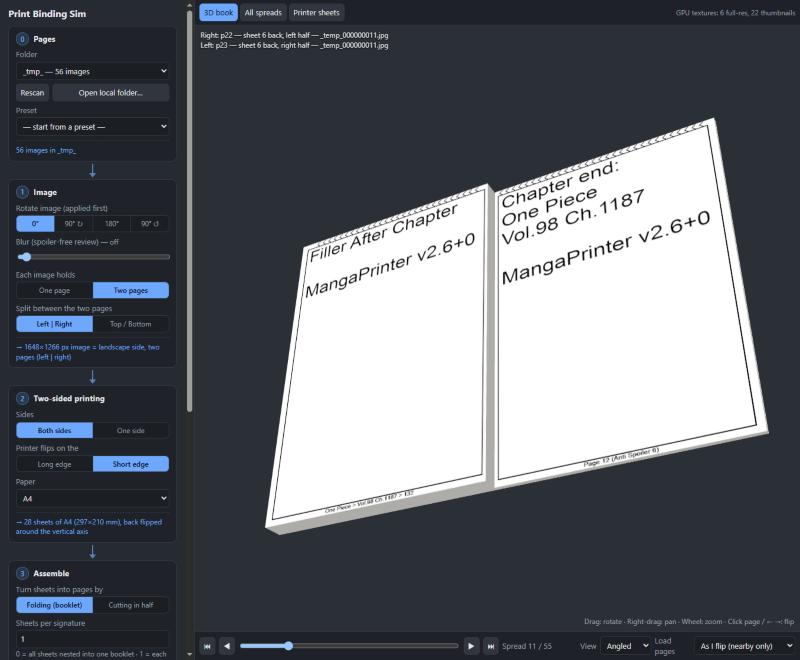

# Print Binding Sim

Preview how a folder of page images will look once printed and bound, before you pay for the print run.



* **3D book**: rotate it with the mouse, click pages (or use the arrow keys) to flip them with a curl animation.
* **All spreads**: every spread drawn at once from thumbnails. Click one to open it in 3D.
* **Printer sheets**: the raw sheet fronts and backs as they come out of the printer.

## Run

```bash
docker compose up --build
```

Then open http://localhost:8080.

The folder mounted at `/data` is scanned for subfolders that contain images, and each one is a print job.
The default is this project folder. To use another one:

```bash
BOOKS_DIR=D:/print-jobs docker compose up
```

You can also pick **Open local folder…** in the UI. That loads the images in the browser, with nothing uploaded.

## Model

Each image is one printed **side**. The images are taken in natural filename order: front, back, front, back… (or fronts only for single-sided printing).

Settings are applied in this order:

| Setting | Meaning |
|---|---|
| Blur | Spoiler-free review. The server blurs every image (thumbnails and the large version, cached), and a local folder is blurred in the browser. Strength is relative to the image size. |
| Rotate image | Applied first. The rotated image is exactly what one printed side looks like, and it sets portrait or landscape. |
| Each image is | **One page**: the whole side is a single page. **Two pages, fold**: fold every sheet in half, front outside. **Two pages, cut**: cut every sheet in half. |
| Fold / cut line | Vertical (left and right halves) or horizontal (top and bottom halves). |
| Sheets per signature (fold) | How many folded sheets are nested together. `0` = one saddle-stitched booklet. `1` = each sheet folded on its own and stacked. |
| After cutting (cut) | **Close like a book**: lay the two half-stacks open side by side, then close the book (same page order as a nested booklet). **One half-stack on top of the other**: pick which half goes on top. **Keep each sheet's halves together**: the two halves of each sheet stay next to each other. |
| Duplex flip long/short edge | The printer-driver setting. The back side is rotated about an axis parallel to that edge of the paper. |
| Spine | The binding edge of the finished book: right = manga / right-to-left. |
| Cover | **The covers**: your first and last printed pages are the front and back cover. **Inside a separate cover**: a cover is wrapped around the printed block, with N blank pages between the cover and page 1 (the same at the back). N is always odd (the inside of the cover plus 2 per blank leaf), because printed leaves cannot be split. That keeps two-page images facing each other. |

When the flip edge doesn't match the fold or spine, a warning appears, and the 3D book shows the backs upside down, just as the real print would.

Textures load by distance. Full resolution is used for the current spread ±1 and thumbnails for ±8 leaves. "Load pages: all at once" keeps a thumbnail of every page on the GPU instead.
Thumbnails are cached in the `pbs-cache` Docker volume. Settings are saved per folder.

## Dev without Docker

You need Python 3.10+ with Pillow, plus `web/vendor/` with three.js r169 (`three.module.js` and `addons/controls/OrbitControls.js`):

```bash
DATA_DIR=. CACHE_DIR=.cache python server/server.py
```

## License

[MIT](LICENSE)
