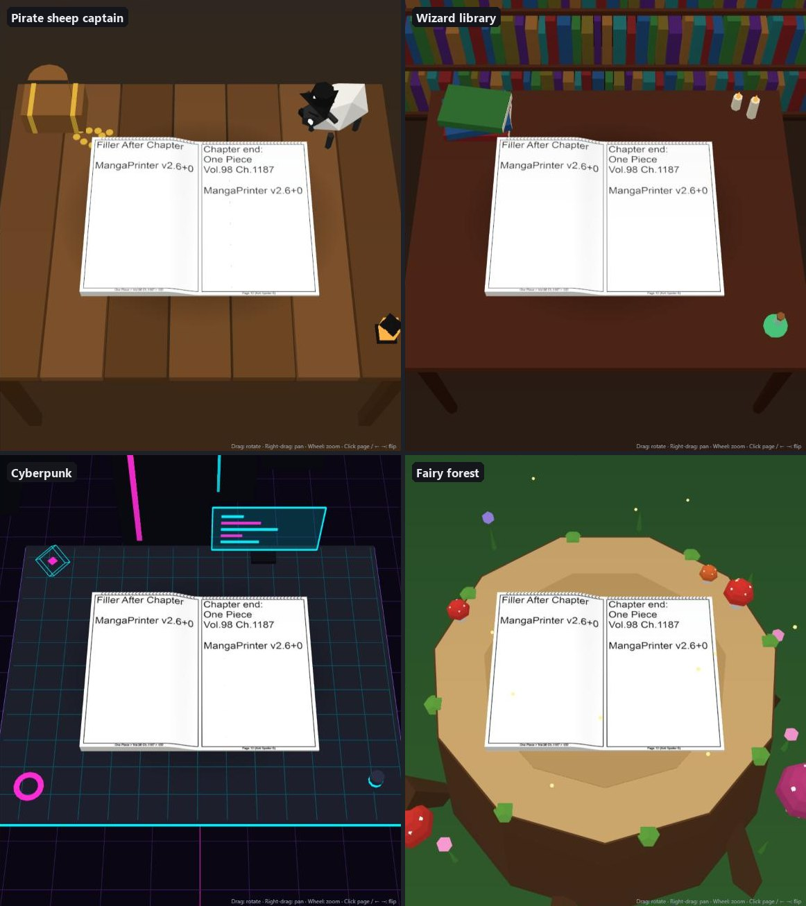

# Print Binding Sim

Preview how a folder of page images will look once printed and bound, before you pay for the print run.


* **3D book**: rotate it with the mouse, click pages (or use the arrow keys) to flip them with a curl animation.
* **All spreads**: every spread drawn at once from thumbnails. Click one to open it in 3D.
* **Printer sheets**: the raw sheet fronts and backs as they come out of the printer.
* **Step-by-step settings**, top to bottom. The Assemble step says in plain words how to fold or cut and stack your sheets, and where each printed sheet's halves end up (e.g. *sheet 1 → p1, p2 … p55, p56*).
* **Scenes**: a low-poly table under the book: pirate sheep captain, wizard library, cyberpunk, fairy forest, or none.



URL options, handy for links: `?theme=pirate|library|cyber|fairy|none`, `?spread=12` (open at a spread), `?zoom=1.5` (start further out), `?software=1|0` (force software-rendering mode on or off).

## Run: portable app (no install, no Docker)

Download `PrintBindingSim-windows-x64.zip` or `PrintBindingSim-linux-x64.tar.gz` from the [Releases](https://github.com/yonixw/PrintBindingSim/releases), unpack it anywhere, and run `PrintBindingSim.exe` (Windows) or `./PrintBindingSim` (Linux).
Your default browser opens the app on a random free port, and the console window shows the address. Close the console window to stop.

* Nothing is installed, no admin rights are needed, and nothing is unpacked to temp. Everything lives in that folder:
  `_internal/` (Python, Pillow, PDFium, the web app) and `data/` (your uploads and the cache), created on first run.
* Unpack it somewhere writable (not `C:\Program Files`). Delete the folder to remove it completely.
* The Linux build runs on glibc 2.31+ (Ubuntu 20.04+, Debian 11+), and Python is not needed.
* Environment overrides: `PORT`, `DATA_DIR`, `NO_BROWSER=1`.

Build it yourself (each OS builds its own):

```bash
pip install -r packaging/requirements-build.txt
python packaging/build.py          # -> dist/PrintBindingSim/ and an archive
sh packaging/build-linux.sh        # Linux build via Docker, also works from Windows
```

Pushing a tag like `v1.0.0` builds both on GitHub Actions and attaches them to a Release.

## No GPU?

The 3D view needs WebGL. On a machine without a GPU (e.g. a VM over remote desktop), the browser may fall back to software rendering, which is slower but works, since the app only redraws when something changes.
If WebGL is not available at all, the app tells you and opens **All spreads** instead; the 2D views always work.
To enable software WebGL in Chrome or Edge, or to test this on your own machine:

```bash
chrome.exe --disable-gpu --enable-unsafe-swiftshader --user-data-dir=%TEMP%\chrome-nogpu http://localhost:8080
```

Check `chrome://gpu`: WebGL should say "Software only". Leave out `--enable-unsafe-swiftshader` to see the no-WebGL fallback.

## Run with Docker

```bash
docker compose up --build
```

Then open http://localhost:8080.

Everything can be done from the UI (step 0):

* **Upload images…**: pick a folder of page images. It is stored on the server in `img/<folder name>/`.
* **Upload PDF…**: stored in `pdf/`. A PDF works like a folder of images, with page *i* as image *i*. Nothing else is read from it.
  Pages are rendered straight from the PDF on demand, the pages you look at first. The rest render in the background with a progress bar, so even a 500 MB PDF opens immediately.
* **Clear all data…**: deletes everything in `img/` and `pdf/` (plus the render cache) after a confirmation. Nothing else in the data folder is touched.
* **Open locally…**: view a folder in the browser only, without uploading it.

The data folder is mounted at `/data`, and the default is this project folder. It must be writable for uploads. Any other image folders or PDFs already in it also appear in the list. To use another location:

```bash
BOOKS_DIR=D:/print-jobs docker compose up
```

## Model

Each image is one printed **side**. The images are taken in natural filename order: front, back, front, back… (or fronts only for single-sided printing).

Settings are applied in this order:

| Setting | Meaning |
|---|---|
| Blur | Spoiler-free review. The server blurs every image (thumbnails and the large version, cached), and a local folder is blurred in the browser. Strength is relative to the image size. |
| Rotate image | Applied first. The rotated image is exactly what one printed side looks like, and it sets portrait or landscape. |
| Each image is | **One page**: the whole side is a single page. **Two pages, fold**: fold every sheet in half, front outside. **Two pages, cut**: cut every sheet in half. |
| Fold / cut line | Vertical (left and right halves) or horizontal (top and bottom halves). |
| Sheets per signature (fold) | How many folded sheets are nested together. `0` = one saddle-stitched booklet. `1` = each sheet folded on its own and stacked. |
| After cutting (cut) | **Close like a book**: lay the two half-stacks open side by side, then close the book (same page order as a nested booklet). **One half-stack on top of the other**: pick which half goes on top. **Keep each sheet's halves together**: the two halves of each sheet stay next to each other. |
| Duplex flip long/short edge | The printer-driver setting. The back side is rotated about an axis parallel to that edge of the paper. |
| Spine | The binding edge of the finished book: right = manga / right-to-left. |
| Cover | **The covers**: your first and last printed pages are the front and back cover. **Inside a separate cover**: a cover is wrapped around the printed block, with N blank pages between the cover and page 1 (the same at the back). N is always odd (the inside of the cover plus 2 per blank leaf), because printed leaves cannot be split. That keeps two-page images facing each other. |

When the flip edge doesn't match the fold or spine, a warning appears, and the 3D book shows the backs upside down, just as the real print would.

Textures load by distance. Full resolution is used for the current spread ±1 and thumbnails for ±8 leaves. "Load pages: all at once" keeps a thumbnail of every page on the GPU instead.
Thumbnails are cached in the `pbs-cache` Docker volume. Settings are saved per folder.

## Dev without Docker

You need Python 3.10+ with Pillow, plus `web/vendor/` with three.js r169 (`three.module.js` and `addons/controls/OrbitControls.js`):

```bash
DATA_DIR=. CACHE_DIR=.cache python server/server.py
```

## License

[MIT](LICENSE)
